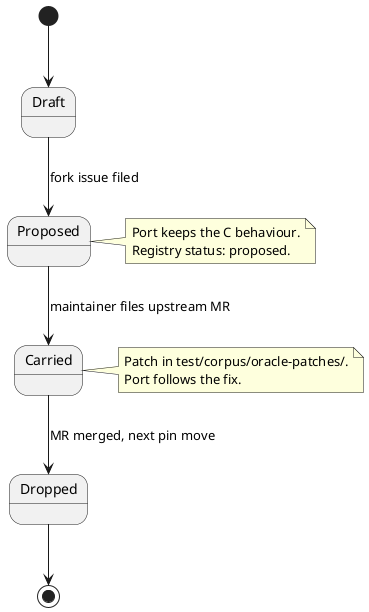

<!-- SPDX-License-Identifier: EPL-2.0 -->

# ADR-0003: Fix graphviz bugs upstream; carry the fix on the oracle

## Status

Accepted 2026-11-19 (mission `plans/graceful-failure/`; decisions D1, D2, D6
and D7 in `plans/graceful-failure/decisions.md`). Replaces one clause of
ADR-0002, decision 1: "oracle = pristine native 16.1.1". The rest of ADR-0002
(build, `oracle-paths.mjs`, `rand()`, order of work, fixtures) is unchanged.

Version clause superseded by ADR-0004 (graphviz 16.1.2).

Amended 2026-11-21: decision 4 requires the repro to work on Ubuntu's latest
LTS. On graphviz#2876 an upstream maintainer on Ubuntu 24.04 could not
reproduce a use-after-free that shows on macOS only because libmalloc zeroes
freed blocks.

## Context

CLAUDE.md treats the C source as sacred. That rule has no answer for a bug in
the C itself. Two cases come up:

- The C crashes or has undefined behaviour. #266 is the first: graphviz#2876,
  a use-after-free in `canon` in `lib/common/output.c`. The port renders
  sanely, but the oracle cannot produce a reference.
- The C output is wrong but deterministic. The port copies it, and the bug
  stays in two places.

The maintainer has decided that such bugs may be fixed upstream, and that the
port follows a fix once the upstream merge request (MR) is filed. The same
model runs in elk-engine (`plans/elk-engine-skeleton/decisions.md` AD-3,
`docs/conformance.md` section 4).

Graphviz bans, for a year, a submitter who sends code they did not read or
understand. Every line sent upstream must be read by the maintainer, who files
every MR.

## Decision

1. **The oracle is the carried build** (D1). It is the 16.1.1 tag plus
   `test/corpus/oracle-patches/*.patch`, applied in lexical order with
   `git am --3way`. Each patch is backported on a fork branch
   `carried/<slug>` at tag 16.1.1 and exported with `git format-patch`.
   The build lives in `/Users/scottseely/git/sseely/graphviz-carried`
   (script `test/corpus/build-carried-oracle.sh`). Plugin dirs are
   `/tmp/ghl1611-carried` (dot) and `/tmp/ghl1611-carried-all` (other
   engines). Locations live in `test/corpus/oracle-paths.mjs`.
   **Pristine 16.1.1 stays as the bisect build**
   (`~/git/graphviz-16.1.1`, `/tmp/ghl1611`, `/tmp/ghl1611-all`). Self-check:
   with zero patches, a deterministic sample of about 60 corpus ids is
   byte-equal to pristine.
2. **The port follows a C fix once the upstream MR is filed** (D2). Filing is
   the maintainer's job, after reading every line. A finding with only a fork
   issue keeps the C behaviour, and its registry row has status `proposed`.
   When the fix merges, the patch is dropped at the next pin move.
3. **Classification ladder** (D6). Each finding gets one class:
   - `mirror`: C fails correctly. The port throws a structured error, now.
   - `graceful`: C crashes or has undefined behaviour and the port renders
     sanely. The port keeps its output and a fork issue is filed. The case
     becomes a U-row once the MR is filed.
   - `upstream-fix`: C output is wrong but deterministic. The port mirrors C
     until the MR is filed, then carries the patch.
   - `port-bug`: the port fails where C survives. It gets a dot-engine GitHub
     issue and is not fixed here.
   - `not-ported`: row only.
   - `port-only`: a port throw with no C counterpart, such as API argument
     checks.

   In the graceful-failure mission only `mirror` sites and the pilot patch
   change `src/`.
4. **Fork actions** (D7). Issues go on gitlab.com/sseely/graphviz. Fix work
   goes on pushed `fix/<slug>` branches: an xfail test commit, then a fix
   commit with a CHANGELOG entry. **Agents never open an MR.** Each issue
   meets the elk-engine fork-issue standard:
   - a check of graphviz/graphviz for a duplicate;
   - a minimal `.dot` repro, run on the oracle and shrunk;
   - the repro's exact command shows the bug on Ubuntu's latest LTS, against
     upstream `main` built from source (a container is enough). If plain
     output looks correct there, as for a memory error under glibc, the
     command that does show it (valgrind, or `MALLOC_PERTURB_` with tcache
     off) is the repro. The issue states that system: release, architecture,
     glibc, and the `dot -V` line;
   - the mechanism at `file:line` with instrumented values;
   - history from `git log -S`;
   - what was and was not checked.

   At most 5 fork issues per run.

## Patch life cycle

| State | Where it lives | Port behaviour |
| --- | --- | --- |
| Draft | `fix/<slug>` branch in a fork worktree | C behaviour |
| `proposed` | Fork issue on gitlab.com/sseely/graphviz; `fix/<slug>` pushed | C behaviour |
| Carried | `NNNN-<slug>.patch` in `test/corpus/oracle-patches/`, exported from `carried/<slug>` at 16.1.1; upstream MR filed | Follows the fix |
| Dropped | Patch deleted at the pin move that includes the merge | Follows upstream |

Only the maintainer moves a patch from `proposed` to carried, by filing the
MR.

## Ban-policy rule

Graphviz bans, for a year, a submitter who sends code they did not read or
understand. So:

- The maintainer reads every line of every fix, test and issue text before
  it is filed upstream.
- The maintainer files every upstream MR. Agents push fork branches and file
  fork issues only.
- An agent never describes a fork branch as "ready to merge". It reports it
  as ready for the maintainer's review.

## Alternatives

- **Keep the C bug in the port, never fix upstream:** rejected. The oracle
  stays unusable on inputs that crash it, and the bug lives in two places.
- **Port a fix as soon as it is written:** rejected. An unfiled fix can
  change or be refused; the port would diverge from every graphviz release.
- **Patch the oracle but leave the port on C behaviour:** rejected. The
  conformance bar would then count a fixed behaviour as a port regression.
- **Let agents file upstream MRs:** rejected (ban policy).

## Consequences

- The oracle is a locally built branch plus a patch series, on top of the
  existing local oracle checkouts. Each machine builds it.
- A carried patch changes references. Every ref that moves is journalled
  against the patch name.
- CLAUDE.md gains a narrow carve-out in "The C Source Is Sacred": only a fix
  whose upstream MR is filed, and which is carried in
  `test/corpus/oracle-patches/`, may change port behaviour.
- Dropping a patch at a pin move is part of that move's checklist.

## Rollback

Reversible. Revert the branch. Removing a patch file and rebuilding returns
the carried oracle to pristine, and pristine 16.1.1 is never touched. Fork
issues and branches can be closed or deleted but not unpublished; the
maintainer approved filing them.
