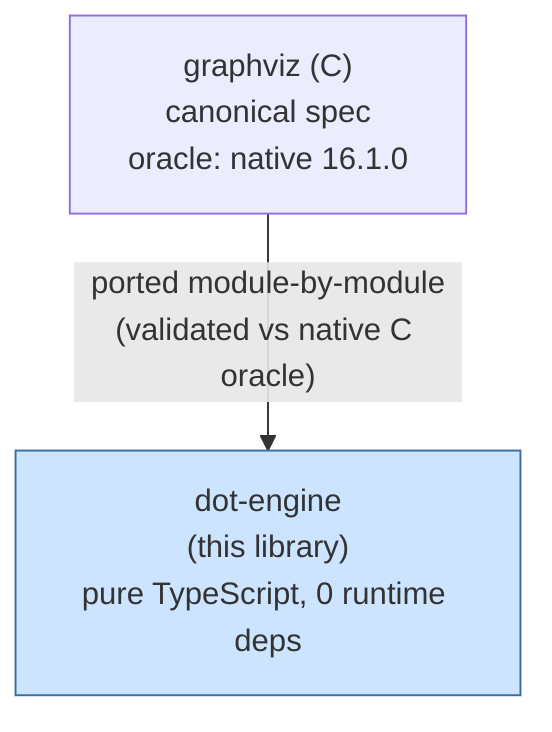
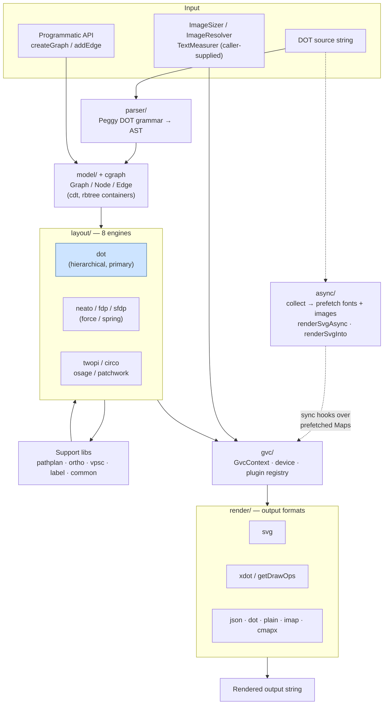

<!-- SPDX-License-Identifier: EPL-2.0 -->

# System Architecture

dot-engine is a single in-process library, not a distributed system. The
"architecture" is the rendering pipeline and its relationship to the upstream
spec. There are no data stores or queues. The library itself makes no network
calls; the external seams are caller-supplied hooks (image sizer and resolver,
text measurer, and for the async API a `FontFaceSet`).

## Repo / dependency context

## Internal rendering pipeline

The layout and render core is **synchronous, in-process function calls** with
no IPC and no protocol. The pipeline below is what executes for a
`renderSvg(dot, engine)` call. The async API (`renderSvgAsync`, `renderAsync`,
`renderSvgInto`) adds one awaited prefetch step in front of the same
synchronous core and never changes it.

## Architectural notes

- **Communication style**: synchronous in-process calls for parse, layout and
  render. `renderSvg` is self-contained — it constructs a fresh `Graph` and
  `GvcContext` per call, so multiple diagrams on one page are isolated (any new
  module-level mutable state must reset per render — a known invariant). The
  async entry points only `await` the font and image prefetch before running
  that same synchronous core on a fresh per-call context.
- **External dependencies**: none at runtime. The I/O seams are caller-supplied:
  `setImageSizer` / `setImageResolver` (image dimensions and bytes),
  `setTextMeasurer`, and for the async API the `imageSizer`, `imageResolver`
  and `fontSet` options. The library never fetches anything itself.
- **Data stores**: none.
- **Plugin model**: `gvc/` mirrors Graphviz's plugin registry — the eight layout
  engines and the output-format devices register through `GvcContext`, matching
  the C architecture rather than introducing a new abstraction.
- **Fidelity boundary**: correctness is defined by the C source. The `dot`
  engine receives the most fidelity attention because downstream consumers
  are dot-centric.
