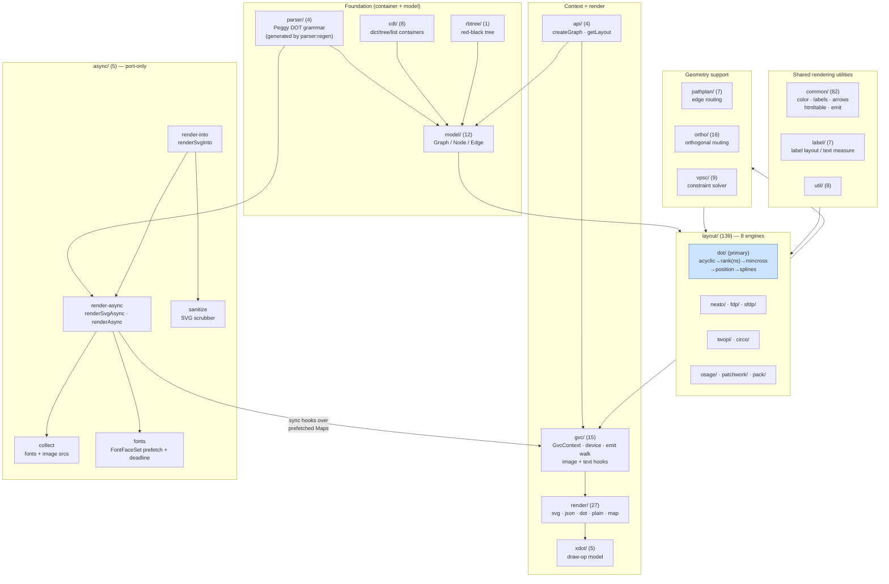
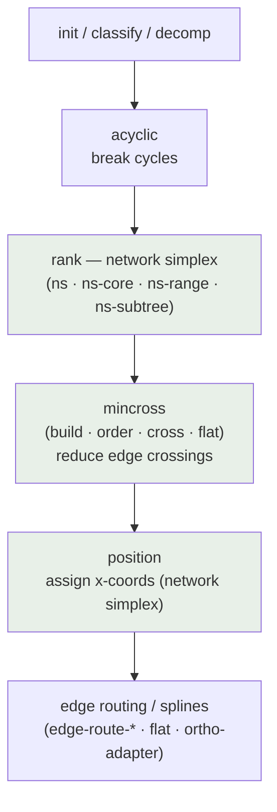
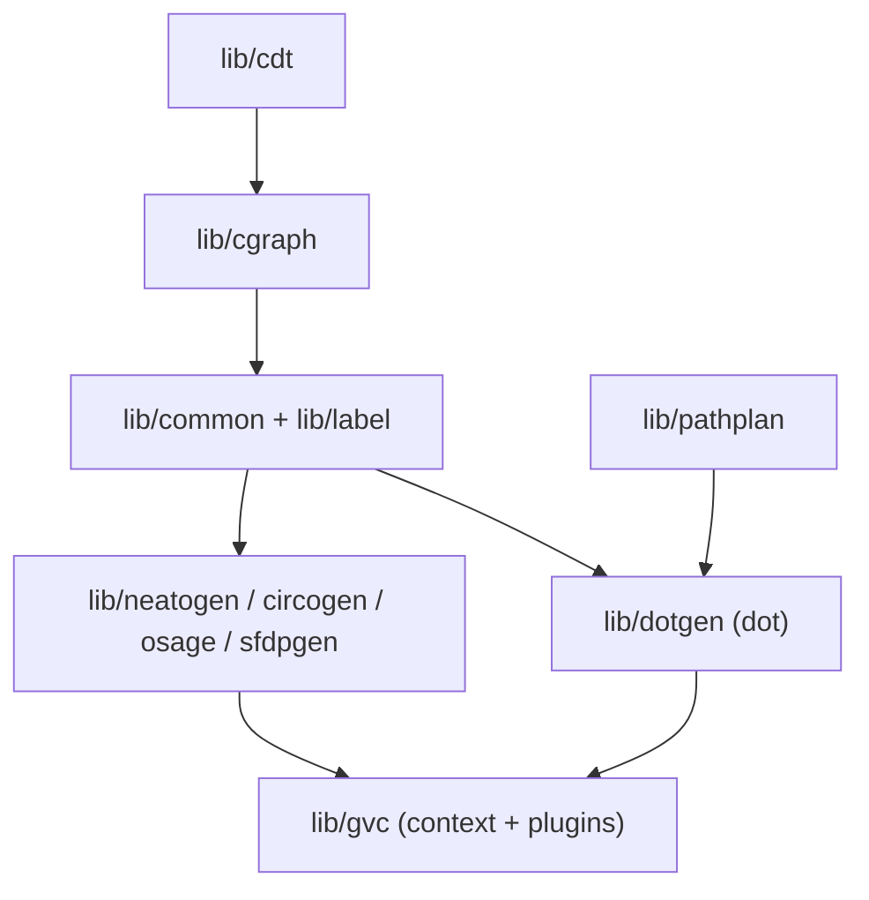

<!-- SPDX-License-Identifier: EPL-2.0 -->

# Component Diagrams

## dot-engine (this project)

`src/` mirrors the C Graphviz module layout. Porting proceeds bottom-up:
container types → graph model → shared rendering utilities → layout engines →
context/plugin layer → render → async layer. Non-test `.ts` file counts are shown per module (725 `.ts` files in `src/` including colocated tests).

### async layer (`src/async/`)

Port-only code with no C counterpart. It wraps the unchanged synchronous
pipeline; it does not alter layout or rendering.

| File | Responsibility |
|------|----------------|
| `collect.ts` | `collectResources(graph, { inlineImages })`: pure scan of the parsed graph for the font faces (mirroring each measurer call site, including HTML-like label items) and the `` / `image=` sources the sync pipeline will request |
| `fonts.ts` | `loadFonts(fontSet, fonts, timeoutMs)`: loads each distinct CSS face through a `FontFaceSet`-like under one shared deadline; never rejects, returns `FontIssue[]` (`failed` or `timeout`) |
| `render-async.ts` | `renderAsync(graph, format, opts)` and `renderSvgAsync(dot, engine, opts)`: parse, `collectResources`, prefetch fonts plus async `imageSizer` / `imageResolver` in parallel, then run `layout → deviceRender → freeLayout` on a fresh context whose image hooks are sync lookups into the prefetched Maps |
| `render-into.ts` | `renderSvgInto(id, dot, engine, opts)`: browser helper that calls `renderSvgAsync`, parses the SVG with `DOMParser` and inserts it via `importNode` + `replaceChildren` (never `innerHTML`) |
| `sanitize.ts` | `scrubSvgDocument`: default deny-list scrubber (script and `foreignObject` elements, SMIL animation, `on*` attributes, `javascript:` and `vbscript:` hrefs, `data:` hrefs other than `data:image/*` on `<image>`, `xml-stylesheet` processing instructions); skipped when `trusted` is set or a custom `sanitize` is given |

`renderAsync` is re-exported through `src/render/index.ts`
(`@knowvah/dot-engine/render`); `renderSvgAsync` and `renderSvgInto` are
exported from the root entry point.

### dot engine internal flow (the primary fidelity target)

## graphviz (C — spec, for reference)

The C module layout each TS module is ported from:

The conformance oracle is the native build of graphviz 16.1.0 (see
[ADR-0001](../adr/0001-graphviz-16.1-oracle.md)).
