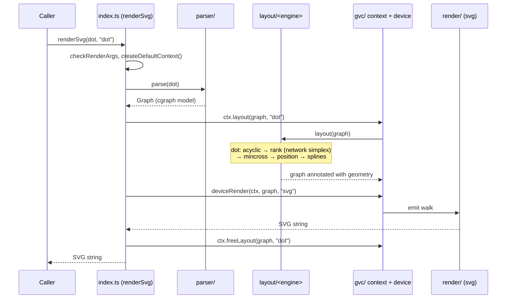
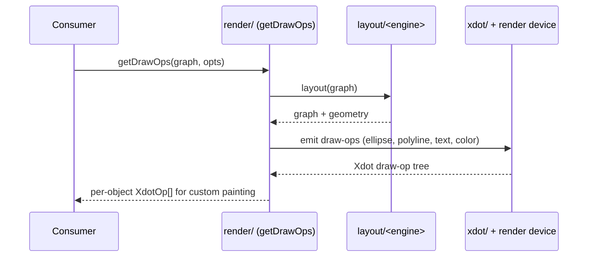
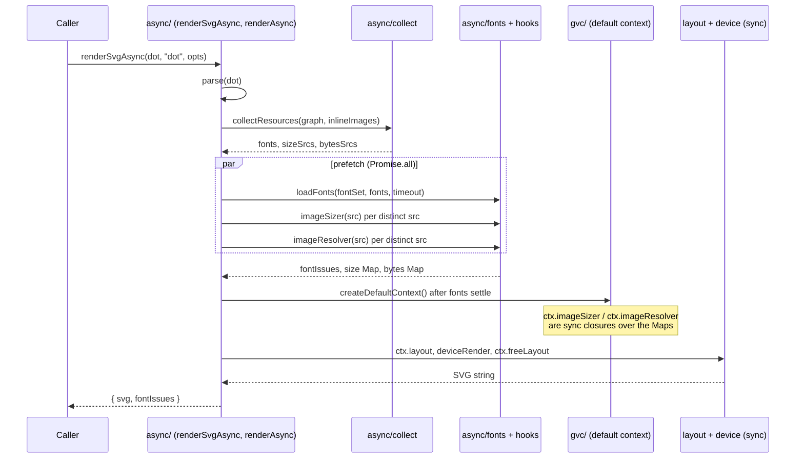
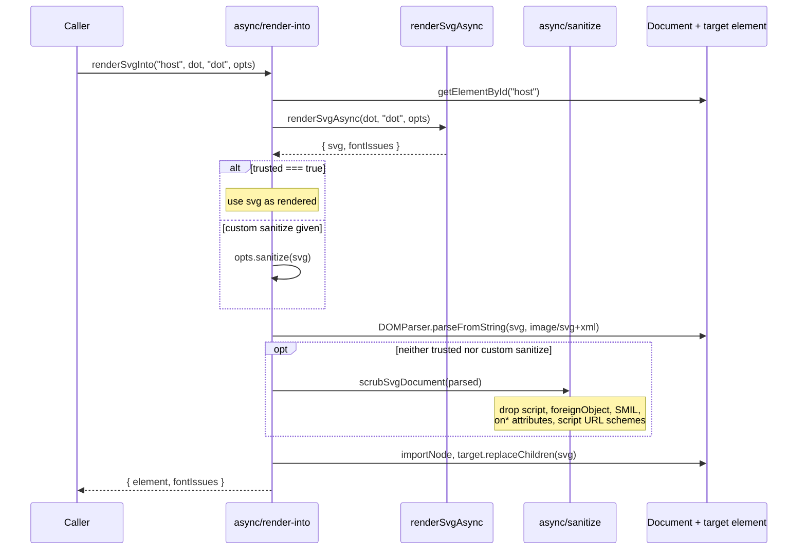

<!-- SPDX-License-Identifier: EPL-2.0 -->

# Data Flow — Sequence Diagrams

The five most important flows in dot-engine. All are in-process and
dependency-free. Layout and render are synchronous; the async flows (4 and 5)
only `await` a font and image prefetch in front of that same synchronous core.

## 1. DOT string → SVG (the primary flow)

`renderSvg(dotSource, engine)` is the headline entry point. The internal
pipeline mirrors C Graphviz: parse → model → layout → render.



A fresh `GvcContext` is created per call and `freeLayout` runs after the
render, as C's `gvFreeLayout` runs after `gvRenderJobs`. Any throw is
normalized at the boundary (`rethrowAtBoundary`) into `ParseError`,
`RenderError` or `InternalError`. `tryRenderSvg` wraps the same flow and
returns a `RenderResult` (`{ svg }` or `{ errors: [one] }`) instead of
throwing; only invalid arguments still throw.

## 2. Programmatic graph → geometry snapshot

For callers that build graphs in code and want raw coordinates (e.g. to render
with their own backend). `getLayout()` requires `render()` to have run first —
there is no standalone layout pass; geometry is a side effect of rendering.

```mermaid
sequenceDiagram
    participant Caller
    participant Api as api/ (createGraph, addEdge)
    participant Render as render/ (render)
    participant Engine as layout/<engine>
    participant Geom as api/ (getLayout)

    Caller->>Api: createGraph(); addEdge(a, b)
    Api-->>Caller: Graph handle
    Caller->>Render: render(graph, "svg")
    Render->>Engine: layout(graph)
    Engine-->>Render: graph + geometry
    Render-->>Caller: rendered output
    Caller->>Geom: getLayout(graph)
    Note over Geom: reads computed geometry,<br/>flips Y-axis to screen coords,<br/>expands edge control points
    Geom-->>Caller: geometry snapshot (nodes, edges, points)
```

## 3. Layout → xdot draw operations

`getDrawOps()` exposes per-object draw operations so a downstream consumer
can paint with a custom renderer instead of the built-in SVG emitter. This is
the integration seam by which dot-engine can replace a consumer's in-house
dot engine.



## 4. DOT string → SVG, async with prefetch (`renderSvgAsync`)

`renderSvgAsync(dot, engine, opts?)` parses first, then delegates to
`renderAsync(graph, "svg", { ...opts, engine })`. Before any layout runs,
`collectResources` walks the parsed graph and lists the fonts and image sources
the synchronous pipeline will request (node, edge, xlabel, head/tail and
cluster labels, HTML-like label items, `` and `image=`). `prefetchAll`
then awaits three things in parallel: `loadFonts` (via a `FontFaceSet`-like,
one shared deadline, `fontTimeoutMs` default 3000), the caller's async
`imageSizer` for `` dimensions, and (only with `inlineImages`) the async
`imageResolver` for image bytes. Each distinct source is looked up once and a
rejected or throwing hook counts as a miss.



Font problems never reject: a failed or timed-out face is returned in
`fontIssues` and logged with `console.warn`. All other failures, including
argument `TypeError`s, are promise rejections with the same classes and codes
as the sync API. `renderAsync` (exported from `/render` and the root) is the
multi-format form of the same flow.

## 5. DOT string → DOM element (`renderSvgInto`)

`renderSvgInto(id, dot, engine, opts?)` is browser-only. It resolves the
document (`opts.document` or `globalThis.document`) and the target element by
`id` before doing any work, then calls `renderSvgAsync` and inserts the result
without `innerHTML`.



A missing document or `DOMParser` is an `ERR_INVALID_STATE` rejection, an
unknown `id` is `ERR_INVALID_ARG_VALUE`, and an SVG that does not parse is a
`RenderError`.
