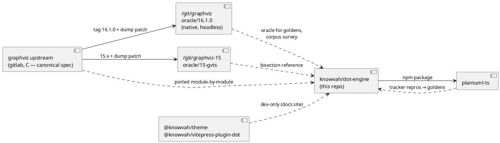

<!-- SPDX-License-Identifier: EPL-2.0 -->

# Architecture Overview

Refreshed 2026-10-16 at `main` = `2983eea8` (PR #92), after the graphviz 16.1
sync and its follow-up PRs #88–#92. Published: `@knowvah/dot-engine` 2.6.x on
npm (semantic-release from `main`, mirrored to GitHub Packages).

## Index

- [overview.md](./overview.md): this document
- [inventory.md](./inventory.md): per-repo runtime/stack inventory
- [tech-health.md](./tech-health.md): version EOL and CVE status
- [architecture.md](./architecture.md): system architecture diagram
- [components.md](./components.md): per-repo internal component diagrams
- [data-flow.md](./data-flow.md): sequence diagrams for key flows, including
  the async API
- [../adr/0001-graphviz-16.1-oracle.md](../adr/0001-graphviz-16.1-oracle.md):
  oracle pin decision

## What the system does

`dot-engine` is a **faithful, pure-TypeScript port of Graphviz**. It parses a
graph in the DOT language, runs one of Graphviz's eight layout engines (`dot`,
`neato`, `fdp`, `sfdp`, `twopi`, `circo`, `osage`, `patchwork`), and emits
`svg`, `dot`, `xdot`, `json`, `plain`, `plain-ext`, `imap`, or `cmapx`.

It has **zero runtime dependencies** and no native binary or WASM. One ESM
bundle runs in the browser, in Web Workers, and in Node (>= 22; Volta pins
26.3.1). `canvas` is an optional peer dependency that is never imported from
`src/`; Node callers opt in to host-faithful text sizing explicitly.

Correctness is defined as **conformance** with the native C build, not byte
equality: within ±0.01 pt for the deterministic engines and ±0.5 pt plus
structural equality for the iterative ones (`neato`, `fdp`, `sfdp`). See
[conformance.md](../conformance.md). The C source is the specification.

## How the repos relate

- **graphviz 16.1.0** is the oracle (ADR-0001). It is a native build with
  `GVBINDIR=/tmp/ghl` holding only the core and `dot_layout` plugins, so text
  is sized by `estimate_textspan_size` and does not depend on installed fonts.
  Non-dot engines need a plugin dir that also holds `neato_layout`. Homebrew
  `dot` is a cross-check only, never the oracle.
- **graphviz 15.x** stays built for bisecting any 16.1 behaviour delta.
- **plantuml-ts** consumes the published package. Its issue tracker feeds
  golden repro tests here (`test/golden`, the "plantuml-tracker" missions).
  Its own version bumps and tracker updates are made in that repo, never from
  here.
- `@hpcc-js/wasm-graphviz` 1.29.2 (graphviz 16.1.0) is a dev dependency used
  only for the speed comparison in `PERF.md`.

## Source layout (`src/`, 725 `.ts` files incl. colocated tests)

| Area | Dirs | C origin |
|------|------|----------|
| Containers / strings | `cdt`, `rbtree`, `util` | `lib/cdt`, `lib/rbtree`, `lib/ast`, `lib/util` |
| Graph model + parser | `model`, `parser` (Peggy grammar, regenerated by `parser:regen`, not committed) | `lib/cgraph` |
| Shared layout/render | `common`, `label`, `xdot` | `lib/common`, `lib/label`, `lib/xdot` |
| Engines | `layout/{dot,neato,fdp,sfdp,twopi,circo,osage,patchwork,pack}`, `ortho`, `vpsc`, `pathplan` | `lib/dotgen`, `neatogen`, `fdpgen`, `sfdpgen`, `twopigen`, `circogen`, `osage`, `patchwork`, `pack`, `ortho`, `vpsc`, `pathplan` |
| Context / pipeline | `gvc` (context, job, device, emit walk, image hooks) | `lib/gvc`, `lib/common/emit.c` |
| Renderers | `render` (svg, dot, xdot, json, plain, map) | `plugin/core` |
| Port-only layers | `api` (builder, geometry snapshot), `async` (font/image prefetch, SVG scrub), `errors.ts`, `debug.ts` | none |

## Public surface (three entry points)

- **`@knowvah/dot-engine`**: `renderSvg`, `tryRenderSvg`, `parse`,
  `GvcContext` + `renderWithContext`; async `renderSvgAsync` and the browser
  helper `renderSvgInto`; host hooks `setImageSizer`, `setImageResolver`,
  `setTextMeasurer` with `CanvasTextMeasurer` / `EstimateTextMeasurer` /
  `LutTextMeasurer`; plus everything in `/api` and `/render`.
- **`/api`**: `createGraph`, `addEdge`, `getLayout`. The geometry snapshot now
  includes spline `sp`/`ep`, head/tail labels, xlabels, and cluster labels.
- **`/render`**: `render(g, format, opts)`, `renderAsync`, `getDrawOps`.
- **Error contract (2.0)**: `DotEngineError` → `InternalError`,
  `RenderError`, `ParseError`; argument misuse throws `UsageTypeError`,
  `UsageRangeError`, `UsageStateError`. Unported engine features (for example
  `overlap=voronoi`, sfdp `quadtree`, `splines=compound` on fdp) **fail
  loudly** instead of silently degrading.

## Key data flows

1. **DOT string → SVG (sync)**: parse → cgraph model → engine layout →
   `gvc` emit walk → renderer. Text is sized by the selected measurer: an
   explicit override, then `GV_TEXT_MEASURER` (tests), then canvas or
   OffscreenCanvas in browser and worker, then the deterministic estimate in
   Node.
2. **DOT string → SVG (async)**: `collect` scans the graph for the fonts and
   images it will request, `fonts` prefetches them under a shared deadline,
   then the sync pipeline runs. `renderSvgInto` scrubs the SVG (`sanitize`)
   before inserting it into the DOM.
3. **Programmatic graph → geometry**: `createGraph`/`addEdge` → `render()` →
   `getLayout()` (Y flipped to screen coordinates).
4. **Layout → draw ops**: `getDrawOps()` returns per-object xdot operations
   for callers that draw with their own backend.

## Verification architecture

- **Golden tests** (`test/golden`): references captured from the 16.1.0
  oracle. The `known-failing.json` ratchet can only shrink and is empty now.
- **Corpus survey** (`npm run survey`, `test/corpus`): every graph in
  graphviz `tests/` across 34 tracks (engine × svg/xdot/json/plain/map/dot).
  Writes JSONL, then generates `PARITY-*.md` pages that state the oracle
  build. Verdicts: conformant, diverged (tracked), accepted, port error or
  timeout (scored as failure), oracle error (excluded).
- **Acceptance registries** (`accepted-divergences-*.json`): each documented
  won't-fix delta, with classes A1–A10 described in
  [known-divergences.md](../known-divergences.md). Since PR #89 the
  registries can express port-error and timeout verdicts, and staleness tests
  fail when an accepted entry starts passing.
- **Attribution** (`attribution-{neato,fdp,sfdp,twopi}.json(l)`): injects the
  oracle's positions to separate layout drift from routing and labelling
  differences. Re-run against 16.1 in PR #91.
- **Perf** (`PERF.md`): warm in-process timing against native, target ≤3×.
- **CI** (`.github/workflows`): `ci`, `docs`, `release` (semantic-release),
  `pr-title` (Conventional Commits lint), `backfill-github-packages`.
  Merges to `main` are rebase-only through PRs, and a push to `main`
  publishes a release.
- **Docs site** (`docs-site/`, VitePress at dot-engine.knowvah.com):
  English plus 23 translations, with a translation-lag gate (`sourceHash`, `scripts/i18n-hash.mjs`)
  and a TypeDoc API reference.

## Current state (oracle graphviz 16.1.0)

| Track group | Pass % | Notes |
|-------------|--------|-------|
| dot svg / xdot / json / map / dot / plain | 99.3 / 100 / 99.8 / 100 / 100 / 99.1 | svg: 1 tracked gap, 5 accepted, 1 port error |
| circo, twopi, osage, patchwork (xdot) | 99.3, 98.2, 99.0, 100 | twopi 1855 is a mirror-image layout (A1) |
| neato, fdp, sfdp (xdot, ±0.5) | 90.6, 96.6, 68.2 | mostly the A1 libm/FMA drift class |
| Perf (dot svg) | 96.6% within 3× | p50 0.15×, p90 1.52×, 1 over-cap; about 3.6× slower than WASM at p50 |

Accepted A10: graph 2784 throws `Map maximum size exceeded` on
circo/twopi/neato/fdp/sfdp. The faithful `pack.c` integer arithmetic needs
about 2.0e9 points, and V8 caps a Map at 2^24 entries.

## Open work feeding the next mission

Source: [plans/post-16.1-followups/README.md](../../plans/post-16.1-followups/README.md)
(untracked). Items 1–6 are done (PRs #88–#92). Open items, each independent,
one branch and PR per item:

| # | Item | Primary area |
|---|------|--------------|
| 7 | Land the circo FMA/association patch (`plans/graphviz-16.1-sync/followups/circpos-fma-assoc.patch`) only after diagnosing why it flips 1855 | `layout/circo` |
| 8 | HTML lexer gaps: unknown-entity and mismatched-tag error paths, and the `table size too small for content` warning | `common/html*` |
| 9 | xlabel placement picks a different candidate after position injection: fdp 2471 (native output is non-deterministic), sfdp 2371 | `label` xlabel placer |
| 10 | `genroute`/pathplan emit none of C's routing warnings (stderr only) | `pathplan`, `common` |
| 11 | Move the remaining `pointset.c` call sites onto the shared `PointSet`: `poly-pack.ts` `psKey`, `htmltable.ts` `used`, `ortho-adapter.ts` `seen`; `PointMap` in neato init only if the difference is observable | `layout/pack`, `common`, `layout/dot`, `layout/neato` |
| — | neato 2371 diverges about 7 pt as unclassified drift | `layout/neato` |

Constraints any mission must keep: work test-first; output must stay
byte-identical on the affected engines; run a fresh corpus sweep with
**0 regressions** before committing; never edit `src/` while a sweep is
running; record every fix in the decision journal.

## Tech stack summary

| Repo | Language | Runtime | Framework | Database | External deps |
|------|----------|---------|-----------|----------|---------------|
| dot-engine | TypeScript 6 (strict, ES modules) | Node >= 22 (Volta 26.3.1) + browser/Worker | none | — | none at runtime; optional peer `canvas`; dev: esbuild, peggy, vitest 4, tsx, vitepress, typedoc, semantic-release, `@typescript/native-preview` (tsgo) |
| graphviz | C | native (CMake build at `~/git/graphviz/build`) | none | — | headless plugin set (core + dot_layout [+ neato_layout]) |

See [tech-health.md](./tech-health.md) for EOL and CVE status.
