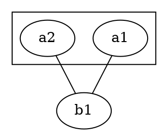

<!-- SPDX-License-Identifier: EPL-2.0 -->
# Upstream draft: fdp-pointer-compare (T13)

Status: fork issue filed, fork branch pushed, no MR (stop 11). The maintainer
reads every line before anything goes to graphviz/graphviz.

- Fork issue: https://gitlab.com/sseely/graphviz/-/work_items/4
- Fork branch: `fix/fdp-pointer-compare` (sseely/graphviz)
- Commits (on `upstream/main` 3d49611e3): test `3bb6d7c91`, fix `0e24ea6ff`
- Duplicate check on graphviz/graphviz (issues and MRs, `--all`): "fdp pointer",
  "fdp nondeterministic", "fdp non-deterministic output", "fdp layout.c ND_id",
  "deriveGraph", "fdp different output each run". Hits (!1658, #2510, #513)
  unrelated; no duplicate.
- No upstream issue number yet: the CHANGELOG entry has none, and the test is
  named descriptively (`test_fdp_pointer_order`).
- Scope note: `docs/known-divergences.md` cites the sites at 16.1.1 as
  `layout.c:466,501,637`; the 16.1.1 lines are 466, 501 and 634 (the third is
  off by three), and at `upstream/main` 454, 489 and 618.

## Upstream issue text

Title: fdp: layout depends on node addresses (pointer comparisons in deriveGraph and genPorts)

### Summary

`deriveGraph` and `genPorts` in `lib/fdpgen/layout.c` order derived nodes by comparing node pointers. When the comparison disagrees with the creation order of the nodes (`ND_id`), fdp lays the same graph out differently. This shows up when one process lays out more than one graph, because the later layouts are allocated at different addresses.

### Reproducer

`cluster.gv`:



```
fdp -Tplain cluster.gv cluster.gv cluster.gv cluster.gv
```

A single layout is stable. With the file given twice, the output of 16.1.1 and of `upstream/main` 3d49611e3 is not always the same, and the two layouts in one run can differ from each other.

Unmodified 16.1.1 build (`dot -Kfdp -Tplain`, file given twice, 12 runs each):

| input | format | distinct outputs (run counts) |
|---|---|---|
| `cluster.gv` | plain | 2 (7, 5) |
| `cluster.gv` | dot | 2 (8, 4) |
| `tests/graphs/fdp.gv` | plain | 2 (8, 4) |
| `tests/graphs/fdp.gv` | dot | 3 (7, 4, 1) |
| `tests/1581.dot` | plain | 2 (7, 5) |
| `tests/1581.dot` | dot | 3 (5, 5, 2) |

One layout per run gives 1 distinct output for each input (12 of 12).

`upstream/main` 3d49611e3 (CMake build, 60 runs, file given twice, per-layout counts): `fdp.gv` plain 2 outputs (60 first layouts: 55 and 5; 60 second layouts: 30 and 30); `cluster.gv` plain 2 outputs (57/3 and 40/20); `1581.dot` plain 2 outputs.

Expected: the same graph gives the same layout every time.

### Mechanism (upstream/main 3d49611e3)

`lib/fdpgen/layout.c` compares pointers at three places:

- `:454` `if (hd > tl)` in `deriveGraph` picks the tail and head of the derived edge.
- `:489` `if (dn > m)` in `deriveGraph` does the same for a port edge.
- `:618` `if (n < other)` in `genPorts` picks the order in which the parallel edges of a cluster are given port numbers and angles.

The derived nodes carry `ND_id`, assigned in creation order (`:402`, `:428`, `:488`).

Temporary tracing at the three sites (`fprintf` of both pointers, both ids and both outcomes) on `cluster.gv` given twice. Run A (output class 1):

```
site1 hd=0x7cb54484d0(id 1) tl=0x7cb5448460(id 0) ptr_gt=1 id_gt=1      first layout
site3 n=0x7cb5448460(id 0) other=0x7cb54484d0(id 1) ptr_lt=1 id_lt=1
site1 hd=0x7cb54485b0(id 1) tl=0x7cb5448620(id 0) ptr_gt=0 id_gt=1      second layout
site3 n=0x7cb5448620(id 0) other=0x7cb54485b0(id 1) ptr_lt=0 id_lt=1
```

Run B (output class 2) has the first layout disagreeing and the second agreeing:

```
site1 hd=0x104cef0b0(id 1) tl=0x104cff670(id 0) ptr_gt=0 id_gt=1        first layout
site3 n=0x104cff670(id 0) other=0x104cef0b0(id 1) ptr_lt=0 id_lt=1
site1 hd=0x78494f0070(id 1) tl=0x78494f0000(id 0) ptr_gt=1 id_gt=1      second layout
```

The id outcome is the same in every run (`id_gt=1`, `id_lt=1`); the pointer outcome is not.

Linking the trace to the output (60 runs, 2 layouts each, 120 layouts): the 70 layouts where the pointer outcome equals the id outcome at every site all gave the same output. Of the 50 layouts where it differs at some site, 44 gave the other output and 6 gave the same one (a flipped comparison does not always change the result).

### Fix

Compare `ND_id` at the three sites. Branch https://gitlab.com/sseely/graphviz/-/tree/fix/fdp-pointer-compare (test `3bb6d7c91`, fix `0e24ea6ff`).

The test `test_fdp_pointer_order` lays `cluster.gv` out 64 times in one process and asserts that the layouts are identical. It is xfail(strict) before the fix: it failed 3 of 3 unmarked runs and reported xfail 5 of 5 marked runs, and passes after (8 of 8). Layouts differing within one process: 60 of 60 runs with 64 layouts, 29 of 40 with 2.

After the fix (60 runs, file given twice): `fdp.gv` plain 1 output, `fdp.gv` dot 1, `1581.dot` plain 1, `1581.dot` dot 1, `cluster.gv` plain 1.

### History

`git log -S'hd > tl'`, `-S'dn > m'` and `-S'n < other'` on `lib/fdpgen/layout.c` each find only 256ef6666 (ellson, 2004-12-23, "Initial revision"). The comparisons are original to the file.

### Checked

- Duplicates in graphviz/graphviz (issues and MRs, `--all`): "fdp pointer", "fdp nondeterministic", "fdp non-deterministic output", "fdp layout.c ND_id", "deriveGraph", "fdp different output each run". Hits (!1658, #2510, #513) are unrelated.
- `upstream/main` 3d49611e3 still has the three comparisons.
- Build, tests and runs are on macOS arm64 (Apple clang, system malloc), Release build, no sanitizer.

### Not checked

- Linux or other allocators: how often the pointer order disagrees depends on the allocator and on process state. The rates above are for this machine; the pointer outcomes in the traces above come from the system allocator's choice of zone and address.
- Other pointer comparisons or other sources of address dependence in fdp (a `sort` or dictionary keyed by pointer): none was looked for beyond these three.
- The full test suite; only the new test and the fdp tests in `test_regression.py` were run.
- `clang-format-19` (not installed; clang-format 23.1.6 gives no diff on `layout.c`). `isort --check` reports `test_regression.py` before and after the change; the same file at `upstream/main` fails it too.
- `1581.dot` with the fix equals the old output only up to `upstream/main`'s own change since 16.1.1; its output at `upstream/main` differs from 16.1.1's with or without the fix.

dot-engine port behaviour: the port orders by `ND_id`. With the fix, the output of `fdp -Tplain` on `fdp.gv` and on `cluster.gv` is byte-equal to the port's, and `-Tdot` on `fdp.gv` is within 1.6e-14. On `1581.dot` the fixed `upstream/main` build differs from the port; the 16.1.1 build equals the port there.

## MR description (style of !5152)

Title: fdp: order derived nodes by id instead of by address

Fixes #<upstream issue number>.

`deriveGraph` and `genPorts` (`lib/fdpgen/layout.c`) decide which end of a
derived edge is the tail, and in which order the parallel edges of a cluster get
port numbers, by comparing two node pointers (`hd > tl`, `dn > m`, `n < other`).
The nodes carry `ND_id`, their creation order. When a process lays out more
than one graph, the later layouts are allocated at different addresses and the
pointer comparison can disagree with the id comparison. The derived edge then
runs the other way, the ports are numbered in the other order, and the same
graph gets a different layout.

Repro:

```
$ cat cluster.gv
graph G { subgraph cluster_a { a1; a2; } b1; a1 -- b1; a2 -- b1; }
$ fdp -Tplain cluster.gv cluster.gv
```

On 16.1.1, 12 runs of this gave 2 distinct outputs (7 and 5 runs). Tracing the
three comparisons shows the id outcome is the same in every run and the pointer
outcome is not; over 120 layouts, all 70 where the two agreed at every site
gave one output, and 44 of the 50 where they differed gave the other.

The comparisons are original to the file (256ef6666, 2004).

The fix compares `ND_id` at the three sites and changes nothing else. After it,
60 runs of the repro and of `tests/graphs/fdp.gv` (as `plain` and `dot`) give
one output each.

The test is `test_fdp_pointer_order` in `tests/test_regression.py`, added first
as `xfail(strict=True)`. It lays the graph out 64 times in one process and
asserts that the layouts are identical.

## Maintainer must read every line

- [ ] The repro and the table of run counts reproduce for you at upstream/main.
      The rates depend on the allocator; the test could pass by chance if no
      layout in a run is allocated out of order. It failed 3 of 3 unmarked runs
      and 60 of 60 in a separate 64-layout measurement here, on macOS arm64.
- [ ] `lib/fdpgen/layout.c`: exactly three one-line changes. `dn > m` becomes an
      id comparison that is always true (the port node is created last); it
      is kept to mirror the other two, not because it can be false. Checked by
      reading, not by a trace.
- [ ] `genPorts`: both `n` and `other` are nodes of the derived graph, so both
      have an id. Checked by reading `:402`, `:428`, `:488`.
- [ ] Other address dependence in fdp (pointer-keyed dictionaries, `qsort` on
      pointers) was not searched for.
- [ ] `tests/test_regression.py`: the test writes the input to `tmp_path` and
      relies on `fdp` being the path-found binary; it skips when `fdp` is
      missing. Built here with `dot_builtins` symlinked as `fdp`.
- [ ] `CHANGELOG.md` wording; issue number to fill in once upstream assigns one.
- [ ] Commit messages carry the `Co-Authored-By` trailer mirroring `c5960b0b7`.
- [ ] Not run: other platforms, the full test suite, `clang-format-19`
      (formatted with clang-format 23.1.6, no diff on `layout.c`), `isort`
      (fails on `upstream/main` too), valgrind/ASan (the defect is not a
      memory error).
- [ ] Ban policy: you have read and understood every line before any upstream
      MR or issue.
