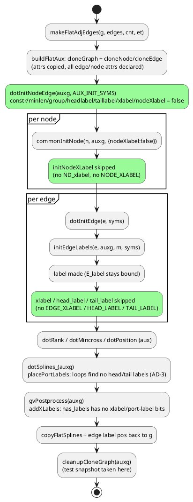

# Data flow: aux init and the passes that see its labels (after the change)

Green steps change in this mission. Before it, the skipped steps made labels C
never makes in the aux, and `addXLabels` and the aux bounding box saw them.
