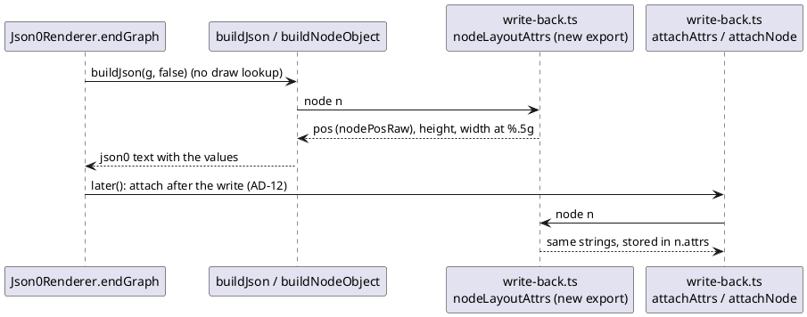

# Data flow: where a json0 node's pos, width and height come from

Proposed state (after T1). Before T1, the json0 branch called `printNum` on
`coord`/`info.width`/`info.height` instead of `nodeLayoutAttrs`.

