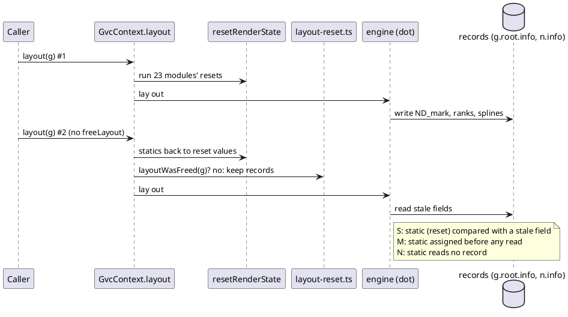

# Data flow: a no-free relayout and the per-render resets

Layout 2 runs on the records layout 1 left, but every registered static starts
again at its reset value. An S static is one whose reset value meets a stale
record field (here `Cmark` against `ND_mark`).

