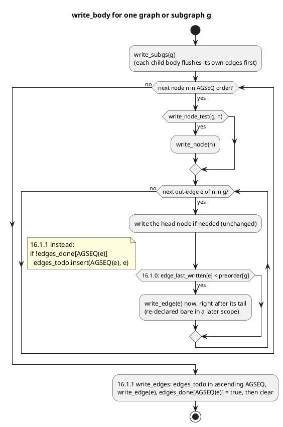

# Data flow: `write_body`, 16.1.0 (port today) against 16.1.1

So 16.1.1 has two effects: within a body, edges follow every node, in creation
order; across bodies, an edge is written only in the first body that reaches
it.
