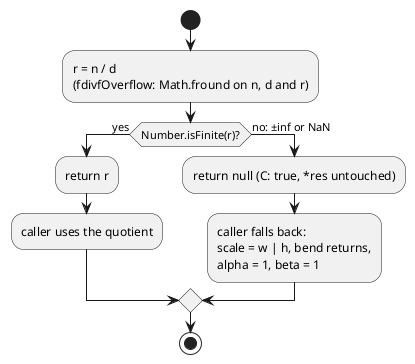

# Data flow: one guarded division (16.1.1 semantics)

The old guards tested only `d == 0`. They differ from 16.1.1 when `d` is
non-zero and the quotient is still non-finite: a subnormal divisor, an
infinite or NaN operand, or a float32 overflow.
