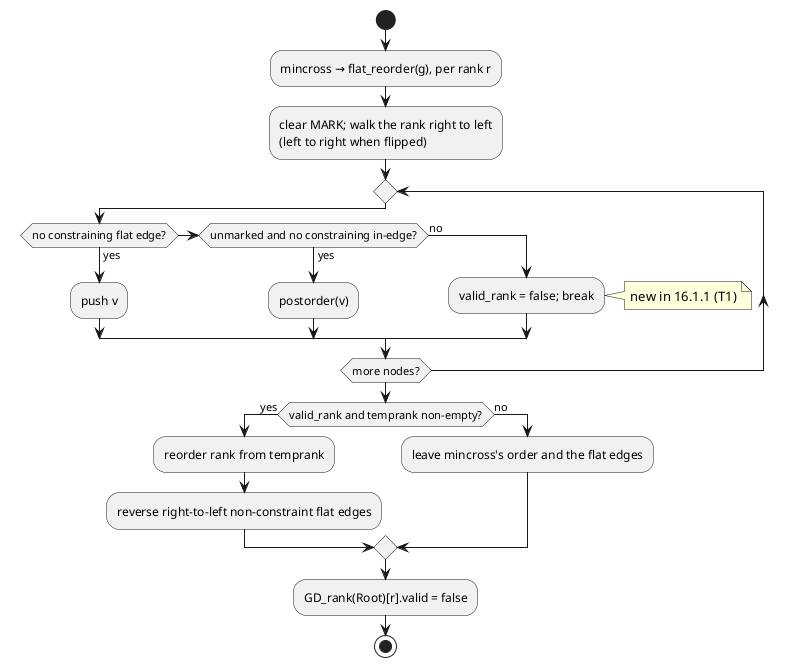

# Data flow: flat_reorder after valid_rank

Downstream, `dot_splines_` routes each run of equal flat edges with
`make_flat_edge`; edge `i` of the run (edgecmp order, seq within a run) gets the
`(i+1)`-th route out (T3).
