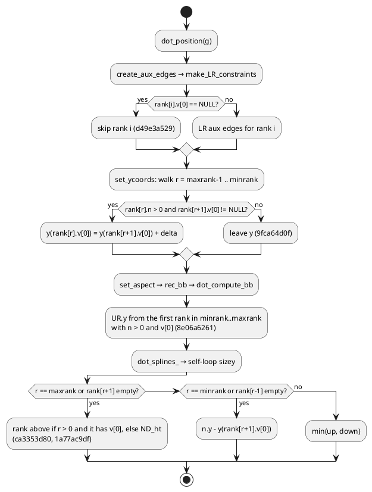

# Data flow: where an empty rank is read

An empty rank reaches these sites today through rank-set deletion
(`2759`: `already in a rankset, deleted from cluster`). After #159 it also
comes from abomination's rank -1 when no flat label vnode fills it.
