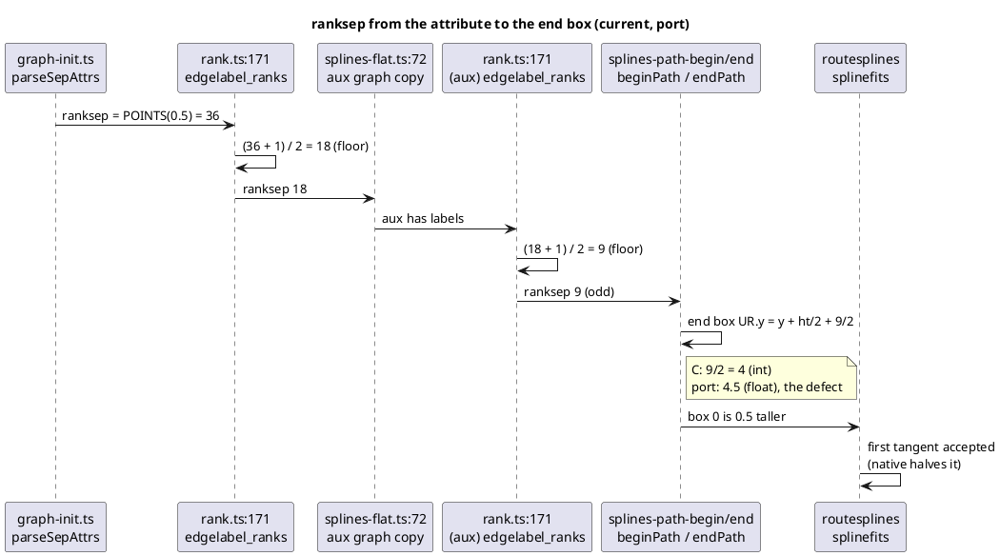

# Data flow: where an odd `ranksep` comes from and where it is read

The repro path: a labelled graph with a flat-adjacent group in `rankdir=LR`.

The sibling, `position-aux.ts:201`, reads `nodesep` the same way, but
`ED_minlen` is even whenever it is reached (decisions.md, AD-2).
