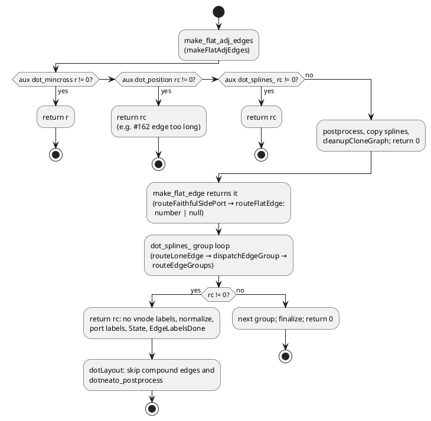

# Data flow: the aux rc, C and head

C's path, which the head follows. A non-zero rc returns at every step. The
head adds the port-only `null` (declined) on the flat routers, which only
ever means "try the next router".

The base differed at two points. `makeFlatAdjEdges` returned `1`, and
`routeFaithfulSidePort` mapped any non-zero result to `false`, so
`routeFlatEdge` fell through to `makeAdjFlatNoPortEdge` and the box-corridor
router, and the group loop never saw a failure.
