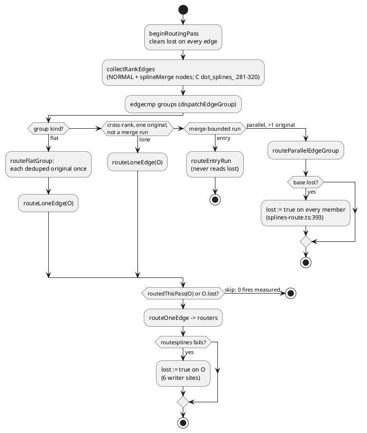

# Data flow: where `lost` is written and read (base)

This is the base. On the head every `lost := true` box and the clear are
gone, the skip tests only `routedThisPass`, and each writer still returns
with no spline installed.

