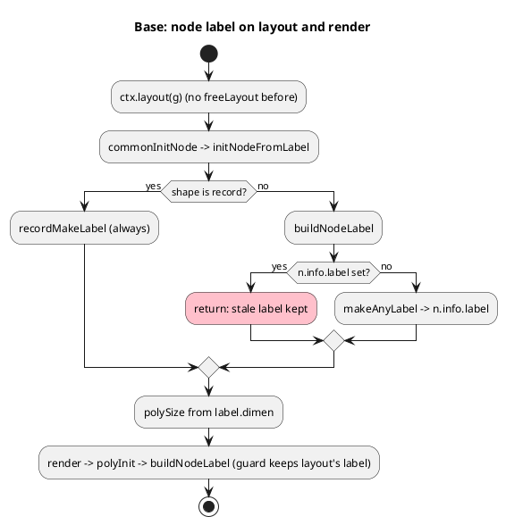
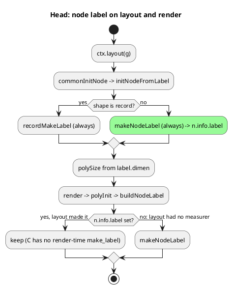

# Data flow: where a node label is made

Base: the layout-time call is guarded, so a no-free relayout keeps the label.

Head: layout always makes the label, as `common_init_node` does. Only the
render-time call is guarded.

