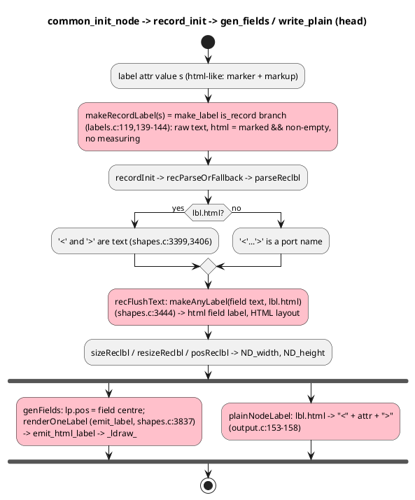

# Data flow: a record node's label, attribute to output

Head (proposed). On the base, the pink steps are a plain-text `makeLabel`
(measured whole, `html` false) and field labels with `html` false.

