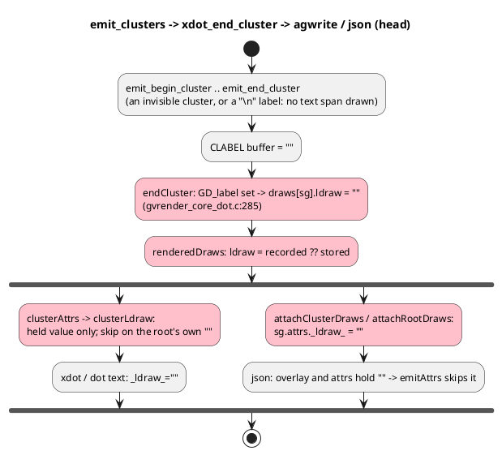

# Data flow: a labelled cluster's `_ldraw_`, render to output

Head (proposed). On the base, the pink steps record, carry and print `_ldraw_`
only when the label buffer is non-empty, so a stored string survives.

