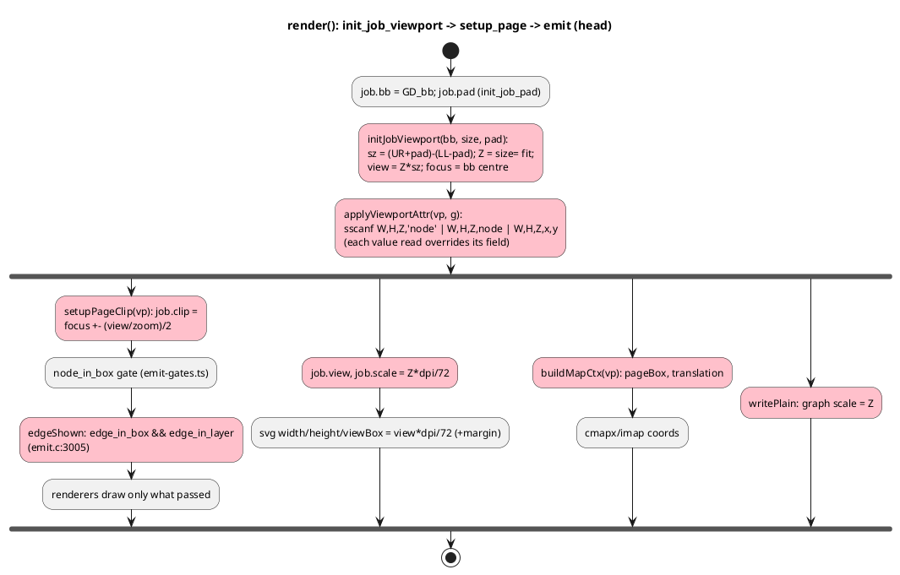

# Data flow: `viewport=` to the page and the emit gates

Head (proposed). On the base, the pink steps derive view and focus from the
bb and never read `viewport`, and the map renderer draws every edge.

