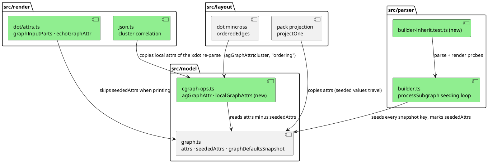

# Component map: issue #242

The builder seeds every inherited graph attribute (green). Two writers learn to
skip seeded keys (green). Layout and render readers change no code; they read
the inherited value through `attrs` from now on.

