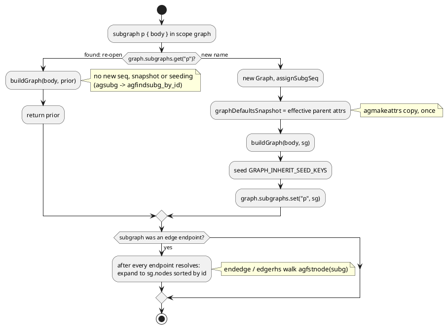

# Data flow: opening a named subgraph (after T1)

C's `agsubg` returns the subgraph the parent already holds; T1 makes
`processSubgraph` do the same. On the base, the `found` branch did not exist:
every opening built a new `Graph` and replaced the old one.

