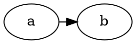

# T6 — Issue 30: port-less edge endpoints in flat-adjacent aux layout

**Agent:** typescript-pro. **Depends on:** T3 (same files). **Rollback:** Reversible.
**Observability:** N/A — no new observable operations.

## Context

plantuml-ts issue 30 (`class/sokevu-87-toce485`, `component/repoge-41-demu604`):

Native: `a->b` = `M54.46,-18C56.43,-18 58.44,-18 60.46,-18`, arrow tip `60.45…70.45`;
port: `M54.28,-18C56.28,-18 58.28,-18 60.29,-18`. The ported edge `a:e->b:w` matches.
C `dotsplines.c:make_flat_adj_edges` (~1122-1290): with any port in the group it
clones both nodes into an aux graph, gives the port-less edge `weight=10000`,
runs rank/mincross/position/`dot_splines_`, then copies back via `transformf`.
Port: `src/layout/dot/splines-flat.ts:366` `makeFlatAdjEdges`, `cloneGraph`
(:69), `runAuxPipeline` (:96), `runAuxSplines` (:104); dispatch
`src/layout/dot/edge-route.ts:363-366`. Note 0.18px ≈ the 54.28 vs 54.46 start —
the port-less edge's start differs where the aux node's boundary/clip or its
aux coordinates differ. `test/diagnostic/flat-aux-dump.ts` already dumps aux state.

## Task

Diagnosis first (AD-7): dump the aux graph (node coords, sizes, edge attrs,
splines before `transformf`) in the port and in an rsync'd instrumented graphviz
copy; find the first divergent value. Artifact →
`.agent-notes/pt30-flat-adj-aux.md`. Then TDD with `test/golden/pt-issue-30.test.ts`
and fix at the origin. If the origin is below the code (proven by controlled
experiment), close `[~]` (AD-7) and leave src unchanged.

## Acceptance

- Given the repro, when rendered, then both edges match `pt-issue-30.svg` within 0.01.
- Given every existing flat-adjacent test (`splines-flat*.test.ts`, goldens),
  then unchanged.
- Given a fresh survey, then 0 regressions vs the post-T5 baseline (if T5 landed
  first) or T0's.

## Read-set

`~/git/graphviz/lib/dotgen/dotsplines.c:1122-1300` (make_flat_adj_edges, transformf),
`src/layout/dot/splines-flat.ts:60-140,360-420`, `src/layout/dot/position-aux.ts`
(only if diagnosis points there), `src/layout/dot/edge-route.ts:355-370`,
`test/diagnostic/flat-aux-dump.ts`.

## Write-set

`src/layout/dot/splines-flat.ts`, `src/layout/dot/position-aux.ts`,
`src/layout/dot/edge-route.ts`, `src/layout/dot/splines-flat.branch.test.ts`,
`src/layout/dot/position-aux.branch.test.ts`, `test/golden/pt-issue-30.test.ts`,
`.agent-notes/pt30-flat-adj-aux.md`.

## Commit

`fix(dot): match port-less edge endpoints in flat-adjacent aux layout`
