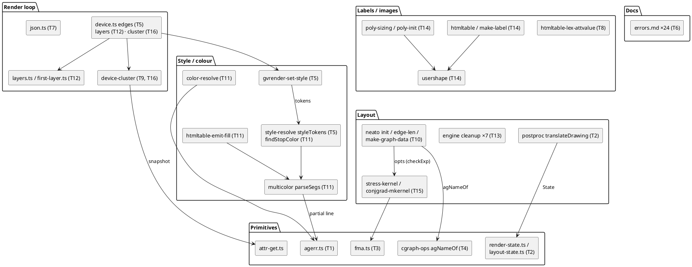

# Component map

Components each task touches (task IDs on the components) and the part-3/part-4
primitives this mission extends: `agerr` (T1 → T11), `render-state` (T2), `attr-get`
(T9 → T16), `conjgrad-mkernel` (T15), `first-layer` (T12).

