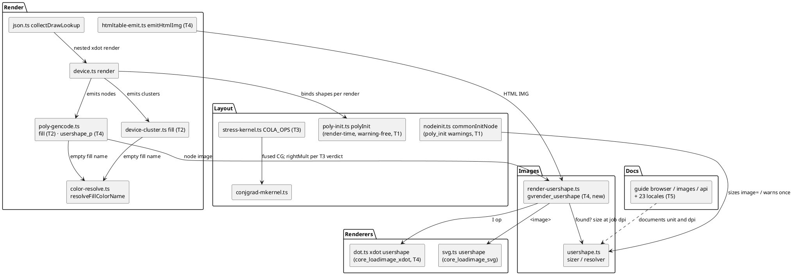

# Component map

Components each task touches (task IDs on the components) and the part-5 seams they
reuse: `usershape.ts` sizing (part 5 T14), `resolveFillColorName` (part 5 T11),
`conjgrad-mkernel.ts` (part 5 T15).

