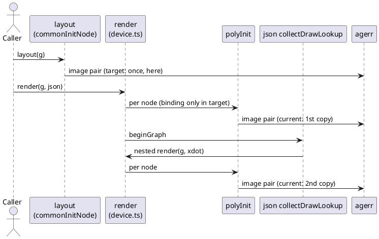
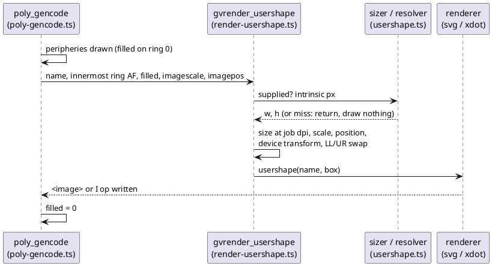

# Data flow

## Item 90: missing-image warnings, current versus target

Current: the warning pair is emitted from render-time `polyInit`, so `-Tjson` prints it
twice. Target (AD-1): emitted once from the layout-time `poly_init` port.

## Item 91: node image drawn (target, AD-2 to AD-4)

