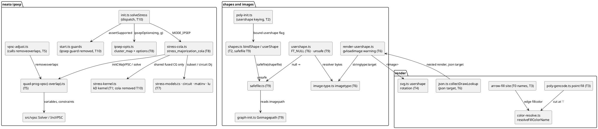

# Component map

The components each task touches, labelled with task IDs, and the existing seams they
reuse: `src/vpsc/` (VPSC solver), `compute-hierarchy.ts` (part 4),
`resolveFillColorName` (part-5 T11), `render-usershape.ts` (part-6 T4).

