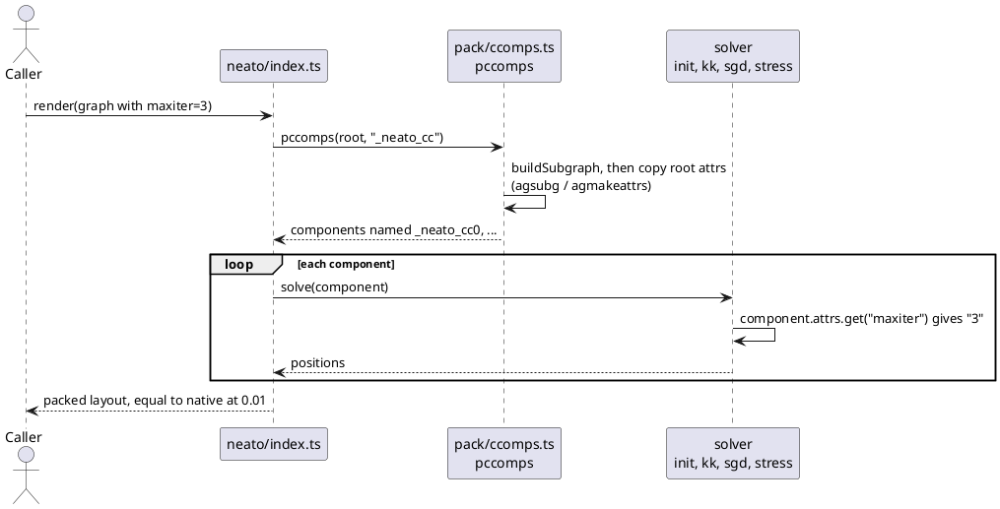
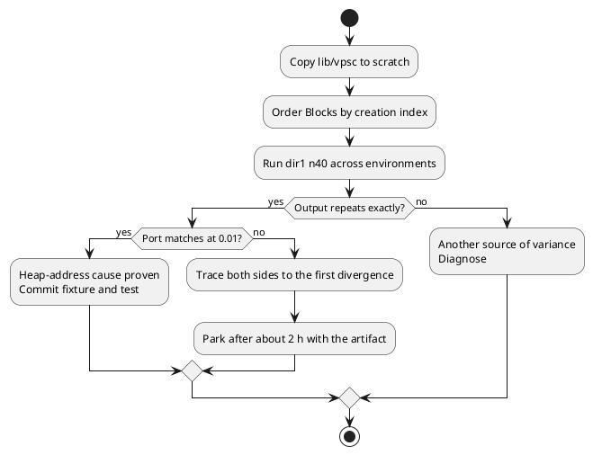

# Data flow: part 9

How a root attribute reaches a neato solver after T2. Before T2, the component's `attrs` is empty, so the solver reads `undefined`
and uses its default.

How T8 separates address order from a real difference.

